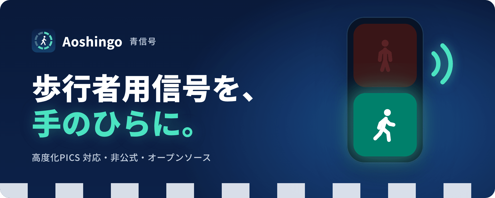
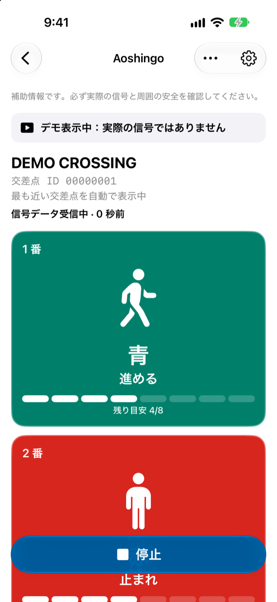
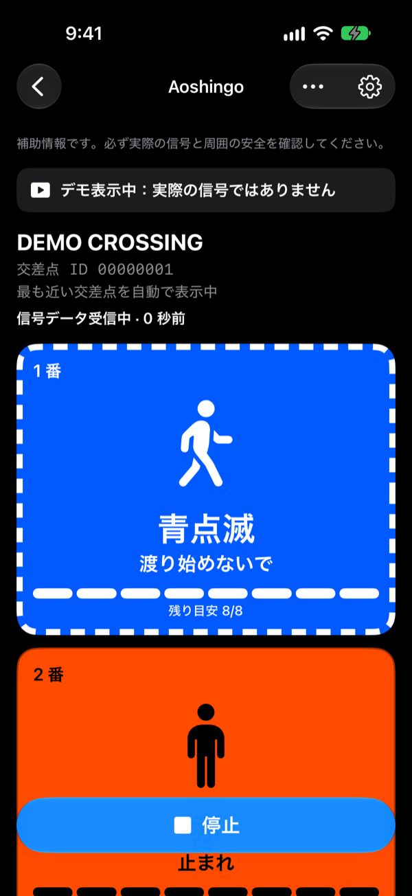
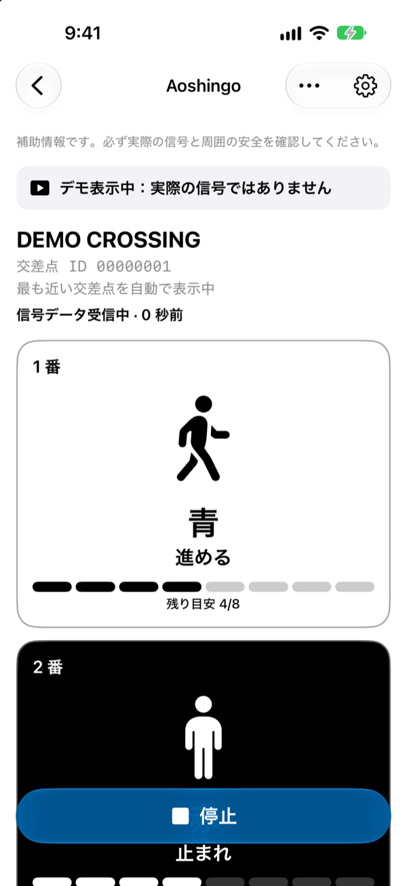

<p align="center">
  
</p>

<p align="center">
  
  
  
  <a href="LICENSE"></a>
  <a href="https://github.com/4sh0u0/Aoshingo/actions/workflows/ci.yml"></a>
</p>

<p align="center">
  <a href="https://aoshingo.4sh.es/"><b>ウェブサイト</b></a>
  &nbsp;·&nbsp;
  <a href="docs/guide.md">使い方</a>
  &nbsp;·&nbsp;
  <a href="https://aoshingo.4sh.es/support/">サポート</a>
  &nbsp;·&nbsp;
  <a href="https://aoshingo.4sh.es/privacy/">プライバシー</a>
  &nbsp;·&nbsp;
  <a href="docs/development.md">開発ガイド</a>
</p>

<br>

交差点の信号機が発信する **高度化PICS** の Bluetooth 信号を受け取り、歩行者用信号のいまの状態を iPhone に表示して読み上げる、非公式のオープンソースアプリです。視覚に障害のある方、色の見え方に違いのある方、横断に時間がかかる方の「いま渡れるか」の判断を補助します。

> [!IMPORTANT]
> **pre-alpha（開発中）** です。App Store ではまだ配布していません。表示は補助情報なので、渡る前に必ず実際の信号と周りの安全を確かめてください。

<p align="center">
  
  &nbsp;
  
  &nbsp;
  
</p>
<p align="center"><sub>左から「標準」「色覚サポート（ダークモード）」「モノクロ」。いずれもデモ表示です。</sub></p>

## できること

- **信号の状態を表示**：最大 6 灯の歩行者用信号と、8 段階の「残り目安」を表示します。
- **声で伝える**：VoiceOver で「1 番、青。進めます」のように読み上げます。
- **自分の信号を決める**：いつも渡る信号に名前・音・振動を設定し、使わない信号は黙らせられます。
- **色に頼らない**：図形・文字・点滅でも区別できます。配色は標準・色覚サポート・モノクロ。
- **安全側に倒す**：青点滅・赤への変化はすぐに、青への変化は 2 回一致してから反映します。
- **受信するだけ**：信号機には何も送りません。
- **データ提供は任意**：初回起動時に選べます。現在地（緯度・経度）は送りません。

くわしくは [使い方](docs/guide.md) をご覧ください。

## 動作環境

- iOS 18 以降の iPhone（XS / XR 以降）と Bluetooth
- 高度化PICS が整備された交差点（全国で約 600 か所）でだけ受信できます
- アプリを画面に表示している間だけ受信します

## ビルド

Xcode 27.1 以降で開きます。

```bash
git clone https://github.com/4sh0u0/Aoshingo.git
cd Aoshingo
open Aoshingo.xcodeproj
```

解析ロジックのテストは macOS と Linux で実行できます。

```bash
swift test --package-path Packages/AoshingoKit
```

署名の設定、実測データの送信先、リポジトリの構成は [開発ガイド](docs/development.md) にまとめています。

## ドキュメント

| 文書 | 内容 |
| --- | --- |
| [使い方](docs/guide.md) | 画面の見方、VoiceOver、ご注意、法令に関する注記 |
| [開発ガイド](docs/development.md) | ビルド、署名、リポジトリの構成 |
| [現地確認の手順](docs/field-test.md) | 対応交差点での受信テストと、記録の共有 |
| [プライバシーポリシー](docs/privacy.md) | 実測データの扱い |
| [送信 API の仕様](docs/field-data-api.md) | アプリと受信サーバー（[`server/`](server/)）の通信 |
| [ウェブサイト](docs/website.md) | 公式サイト（[`site/`](site/)）の構成と公開 |

## コントリビュート

Issue と Pull Request を歓迎します。対応交差点で受信した記録ファイルは、解析とテストにとても役立ちます。記録には交差点と時刻が含まれるので、共有する前に [現地確認の手順](docs/field-test.md) をご覧ください。

## 謝辞

高度化PICS の解析は、[yumu19/ble-pics-viewer](https://github.com/yumu19/ble-pics-viewer)（MIT License, Copyright (c) 2025 Tsubasa Yumura）の解析仕様と実装を参考に、Swift で再実装したものです。受信方法と解析結果を公開してくださった作者に心より感謝します。

## ライセンス

[Apache License 2.0](LICENSE)。第三者のライセンスは [NOTICE](NOTICE) と [THIRD_PARTY_NOTICES.md](THIRD_PARTY_NOTICES.md) をご覧ください。

警察庁、信号機メーカー、「信GO!」とは関係のない非公式アプリです。
